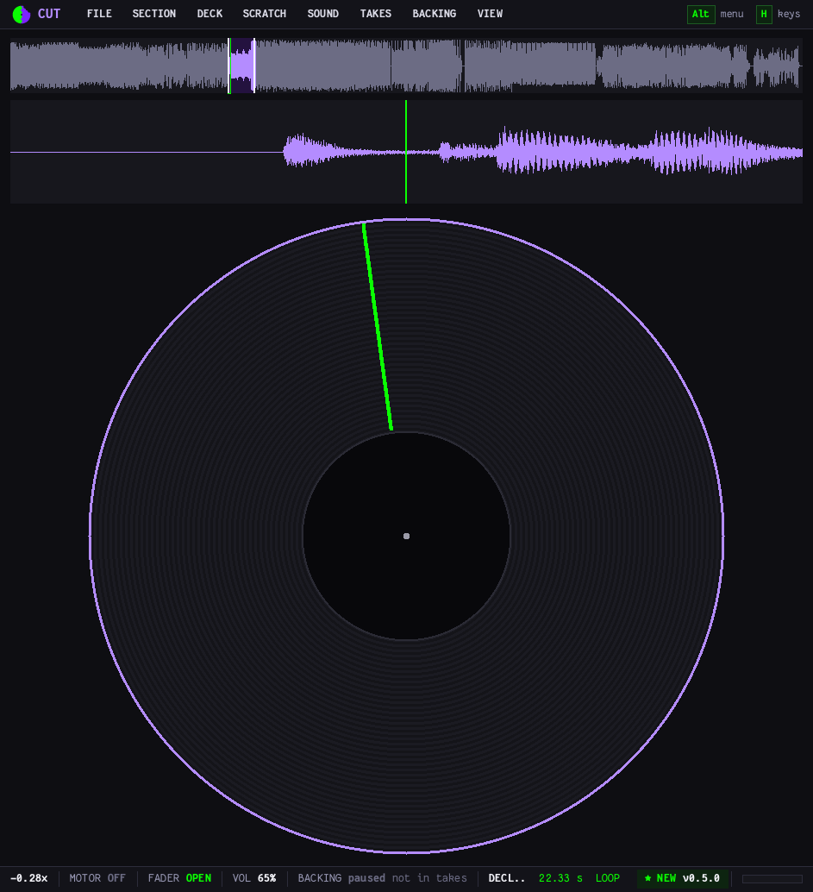

# CUT

[](https://github.com/Galactable/cut/actions/workflows/ci.yml) [](https://github.com/Galactable/cut/releases/latest)

A vinyl scratch deck for Linux. Load a sample, or record one straight from whatever your computer is playing (a YouTube video, a film), then scratch it with your fingers on a laptop touchpad, a drawing tablet's touch surface, a MIDI DJ controller's jog wheel, or nearly any other input device. Load a beat as a backing track to scratch over, then record your takes as WAV or MP3 to drop into your DAW.

It's modelled on a real turntable: your hand controls the record's position, the platter spins on a slipmat, and the sound goes through a modelled cartridge and phono stage.



## Install

CUT runs on Linux, on Wayland and X11 desktops (see [Running on other Linux systems](#running-on-other-linux-systems)). Pick one of three ways:

### Option 1: ready-made download (easiest)

1. From the [latest release](https://github.com/Galactable/cut/releases/latest), download `cut-<version>-linux-x86_64.tar.gz`.
2. Extract it and install it from a terminal:

```bash
tar xzf cut-*-linux-x86_64.tar.gz
cd cut-*-linux-x86_64
./install-desktop.sh   # puts CUT in ~/.local/bin and in your app launcher
./input-access.sh      # lets CUT read touchpads, tablets and gamepads directly (asks for your password)
```

You can delete the download folder afterwards. It runs on current Ubuntu, Debian, Fedora, Arch and their relatives on x86_64. The dialogs need `zenity`, the touchpad features on X11 need `xinput` and recording what's playing needs `parec`; most desktops have all three, and otherwise they're one package-manager command away.

To update, download the new release and run `./install-desktop.sh` again. `./install-desktop.sh --remove` uninstalls it.

### Option 2: Arch, CachyOS, Manjaro (package)

Build CUT as a proper Arch package, so pacman installs and removes it cleanly:

```bash
git clone https://github.com/Galactable/cut.git
cd cut/packaging/aur
makepkg -si
```

The package includes touchpad and tablet access, so there's no `input-access.sh` step. To update later, run `git pull` in the `cut` folder, then `makepkg -si` again in `packaging/aur`. CUT is coming to the AUR as `cut-deck` (so `yay -S cut-deck` will work) once AUR sign-ups reopen.

### Option 3: build from source

**1. Install the build tools and libraries**

```bash
# Arch, CachyOS, Manjaro
sudo pacman -S --needed base-devel git curl alsa-lib jack zenity xorg-xinput libpulse
# Debian, Ubuntu, Mint, Pop!_OS
sudo apt install build-essential git curl pkg-config libasound2-dev libjack-jackd2-dev zenity xinput pulseaudio-utils
# Fedora
sudo dnf install gcc git curl pkgconf-pkg-config alsa-lib-devel pipewire-jack-audio-connection-kit-devel zenity xinput pulseaudio-utils
```

**2. Install Rust** (skip this if you already have it)

```bash
curl --proto '=https' --tlsv1.2 -sSf https://sh.rustup.rs | sh
```

**3. Download and build CUT**

```bash
git clone https://github.com/Galactable/cut.git
cd cut
cargo build --release
```

**4. Optional extras**

```bash
./install-desktop.sh   # adds CUT to your app launcher, with its icon
./input-access.sh      # lets CUT read touchpads, tablets and gamepads directly (asks for your password)
```

`./install-desktop.sh --remove` takes CUT out of the launcher again. Re-run it if you move the folder.

**Update** to the newest version later:

```bash
cd cut && git pull && cargo build --release
```

These steps are checked automatically on fresh Ubuntu, Fedora and Arch systems every time CUT changes.

Whichever way you install, audio files keep opening in your usual player, and CUT shows up under "Open with".

## Run

Start CUT from your app launcher, or from a terminal:

```bash
cut-deck "path/to/sample.wav"                   # installed (download or AUR)
./target/release/cut-deck "path/to/sample.wav"  # built from source, in the cut folder
```

You can also start it with no file and drop a file onto the window (X11 only for now), or press **O**.

## Quick start: scratch a sample over a beat

1. **Load the sample you want to scratch.** Press **O** (or drop the file onto the window), or press **W** to [record it from a video or film](#sample-from-a-video-or-film-w). Drag across the top waveform to pick the part that goes on the record: a word, a stab, an "ahh".
2. **Load the beat.** Press **Y** and choose a beat or a whole song. It plays under the record and loops.
3. **Start both.** Press **B** to play the beat and **M** to start the record turning.
4. **Scratch.** Put your hand on the record (two fingers on a touchpad, one on a tablet, a jog wheel, or a mouse drag) and cut with the crossfader (**Space**, or a button you set up in **File > Devices**). The crossfader only cuts the record, so the beat keeps playing.
5. **Balance the levels.** **Up**/**Down** set the record's volume, and **Backing > Volume up / down** set the beat's (the menu stays open while you click).
6. **Record a take.** Press **R** to start and **R** again to stop. The beat jumps back to its start the moment recording begins, so the take and the beat begin together.
7. **Use it in your DAW.** Put the beat on one track and the take on another, both starting at the same point. They line up. The take is the scratch alone, so you can mix, EQ and edit it separately.

To keep the beat in the take as well (for a practice clip or a quick share), turn on **Backing > Record it into takes** before recording.

## Sample from a video or film (W)

CUT can record whatever your computer is playing and put it straight on the record, so you don't have to record it in another program, import the file and cut it.

1. **Press W.** CUT starts recording what the computer plays. The status bar shows **RECORDING PC AUDIO** with a timer, and the level meter shows what's being picked up.
2. **Play the part you want** in your browser, a media player or any other app.
3. **Press W again.** The recording goes on the record, ready to scratch.
4. **Pick your cut and save it.** Drag across the top waveform to choose the part you want, then **S** saves it to your library.

- **Silence is trimmed.** The quiet before the first sound and after the last is cut off, so you can press **W** first and start the video afterwards.
- **The whole recording is kept** in `<samples folder>/Captures` (default `~/Music/CUT/Captures`), as WAV, or MP3 if you've switched **File > Save format**. **,** and **.** step through earlier recordings once one is loaded.
- **CUT is silent while it records,** so the record, the click and the backing track don't end up in the recording. Other sounds the computer makes, such as notifications, are picked up.
- **It records the default output,** the one your desktop's volume control is set to. If the video's own volume is turned down in its player, the recording is quieter too.
- **It stops by itself after 10 minutes** and loads what it has.
- **Quitting while it records** saves the recording to the Captures folder first.
- **Put it on a controller:** in **File > Devices**, give "Record what's playing" a button.
- It needs `parec`, which most desktops already have (see [Running on other Linux systems](#running-on-other-linux-systems)).

## What makes it sound like vinyl

- **Your fingers control the record's position, not its speed.** It's the same as a hand on vinyl, so speed comes from how you move.
- **The record sits on a slipmat.** The motor keeps turning underneath, so letting go speeds the record up in about 12 ms, and motor start/stop spin up and down like a Technics.
- **It plays through a modelled cartridge and phono stage.** The groove is cut with RIAA EQ and read back as stylus velocity. Slow drags sound bassy and soft, fast cuts sound bright and punchy, and holding still is silent. **Sound > Vinyl EQ** turns this off so you can compare.
- **Fast scratches don't alias.** The resampler's filter follows the speed, so you don't get the usual digital fizz.
- **Touch movement is smoothed.** Touch surfaces report 100-130 times a second. Each point is glided to and passed through a spring, so you hear motion instead of a stair-step buzz. **Scratch > Smoother** and **Snappier** set how much smoothing there is.

## Other devices: DJ controllers, gamepads, dials, pads

Open **File > Devices** to see every input device CUT can use, including ones plugged in while it's running. Touch any control and its device lights up in the list.

- **Guided setup** walks you through it. First, move what you want to scratch with (a jog wheel, dial, touch ring, knob or stick) and press Enter. Then turn it exactly once around to calibrate a record turn. Then press the buttons for the crossfader, hold record (or touch a jog's top plate), motor, back to cue and record take, and set the volume control. **Tab** skips a step.
- Most other commands can be given a control too (hot cues, click, backing track, recording what's playing, previous and next file, the trainer strip, fixing the beat and more): pick its row and press the control. **Del** clears a row.
- **Sensitivity** (← →) and **scratch direction** are per device, on top of the controllers' **Scratch > Less / More sensitive** setting.
- MIDI controllers show up without any access setup; learn their controls here like any other device. Relative jogs (64-centred or two's complement), absolute knobs and faders, notes and CC buttons are told apart while you learn them.
- While CUT is focused it takes a set-up device from the desktop, so its buttons don't also type or click. It gives the device back when you switch away. You can turn this off per device.
- Touch surfaces have one setting: work as a **touchpad** (two fingers scratch, one is the cursor) or a **tablet** (one finger scratches).
- A device marked **needs access** can be unlocked from the menu (asks for your password). This writes a udev rule for that one device only, by vendor, product and name. `./input-access.sh --remove` takes all of it back.
- Setups are plain text files in `~/.config/cut/devices/`, one per device model, so you can copy them to another machine or share one for a controller. They only list what you've set: controls, plus `grab=false`, `sens=` or `reverse=true` if you changed those from the defaults.

## Wacom Intuos Pro

The ExpressKeys and touch ring work as soon as the tablet is plugged in, once CUT can read the tablet (run `./input-access.sh` once, or unlock the pad from **File > Devices**). The pad comes set up with the layout below, and you can change it in **File > Devices**. On X11, `tablet-setup.sh` still works if you prefer the desktop to handle the keys (on Wayland the desktop's own tablet settings do that):

```bash
./tablet-setup.sh
```

- **One fingertip** on the tablet's touch surface is your hand on the record. While CUT is focused the desktop ignores the touch surface, so it's scratch-only; switch away or quit and it's a normal touch surface again. Quick taps work for stops and skips.
- A grab holds until every finger lifts, so a finger skipping off mid-stroke doesn't let go.
- Keep the pen off the tablet: the tablet ignores touch while a pen is near it. CUT doesn't use the pen.
- The top 3 ExpressKeys are **hot cues 1-3**. Hold one for a second to put that cue where the needle is in the section; a numbered marker appears on both waveforms. Keep holding to three seconds to remove it. Tap it to jump straight there. On the keyboard they're **F2 F3 F4**.
- The 4th key, next to the ring, is the crossfader: held cuts the sound. **I** flips this to hamster mode, where held opens it.
- The button in the middle of the touch ring holds the record, and the 4 keys below the ring are back to cue, record take, click and motor. The touch ring is volume. Change any of it in **File > Devices**.
- Hot cues are cleared when you load another file. Picking a new section keeps the ones that are still inside it.
- To undo the tablet setup: `./tablet-setup.sh --reset`.

The whole touch surface is scratch area whatever size the window is; CUT reads the tablet directly. **Scratch > Scratch motion** switches between AUTO, left/right, up/down and circular platter motion.

## Laptop touchpad

One-time setup from the `cut` folder (or the extracted download), so CUT can see your fingers directly (asks for your sudo password). The AUR package already includes it:

```bash
./input-access.sh
```

This only gives read access to touchpads, tablets, tablet pads and gamepads. Keyboards and mice stay root-only.

- Two fingers down puts your hand on the record. Move them to scratch, hold them still to hold the record, lift to let go.
- One finger is the normal cursor. While two fingers hold the record, the desktop pauses the touchpad, so nothing scrolls or clicks outside the app.
- Touch only scratches while the CUT window is focused.
- Tap-to-click is off while the pointer is over CUT (a tap is a quick record stop there). Move the pointer onto another window and tapping works again, so you can tap it to switch.
- Without the setup, two-finger scrolling still scratches, but pausing counts as letting go.

## Feel

- Each input (touchpad, tablet touch, mouse, controllers) has its own sensitivity, and the touch surfaces and mouse have their own scratch motion. The sensitivity and scratch motion items in the **Scratch** menu change the one you used last. They're saved in `~/.config/cut/settings.txt`.
- **Scratch > Less / More sensitive** change sensitivity (shown as x1.00; the menu stays open while you click). Controllers share one setting, and each device has its own on top of it (see **File > Devices**). At x1.00 a quarter-second scratch is about 1.6 cm on the touchpad and 5 cm on the tablet.
- **Scratch > Smoother / Snappier** change smoothing: lower feels heavier, higher feels snappier. The status bar shows the current value as SMOOTH.
- **Up** / **Down** set the record's volume, up to 150%. VOL turns red above 100%: from there CUT's limiter squashes loud peaks, in your takes too, so keep it at 100% or below for clean takes. A knob or slider set up in **File > Devices** covers the same range.
- **Scratch > Scratch motion** switches it: AUTO (follows whatever line you scratch along, right/up = forward), left/right, up/down, or PLATTER (circle round the centre of the tablet, clockwise = forward, one turn = 1.8 s like a real 33). Tablet touch defaults to platter, and a dot on the on-screen record shows where your finger is.

## Start-up and view

- CUT opens with the key guide hidden, paused, with an empty record on the platter. Press **M** to start it: the empty run-out groove plays hiss, crackle and a scuff that ticks once per turn until you load a sample.
- **H** shows or hides the key guide. **Alt** (pressed and released on its own) or **F10** opens the menu bar, which has every command. The keyboard only keeps the keys you use while playing: see [Keys](#keys).
- **View > Background image** puts your own picture behind everything, and **View > Record image** puts one on the record, where it turns with the record. **View > Record image covers** switches it between the whole record and just the label in the middle. PNG, JPG and WebP work. Choose the same item again to take the picture away. **View > Dim background** dims it (0% to 80%, 60% to start) so the waveforms stay readable.
- **View > Record grooves** turns the record's groove rings on or off, and **View > Cue line** the green cue line. Pictures and these choices are saved in `~/.config/cut/settings.txt`, not in profiles.
- **File > Profiles** opens profiles: save your current feel and mixer settings under a name, and load them back later (for example one per controller or per routine).
- **Ctrl+Q** quits. Quitting mid-take finishes the take first, and quitting while recording what's playing saves that recording.

## Keys

The keyboard only has what you reach for while playing; everything else is in the menus (**Alt** or **F10**), and almost all of it can go on a device button in **File > Devices**. **H** shows these on screen.

| Key | What it does |
| --- | --- |
| **Space** | Crossfader: cuts while held (**I** flips it to hamster) |
| **Shift** | Hand on the record while held |
| **M** | Motor on / off |
| **C** | Back to cue |
| **F2** **F3** **F4** | Hot cues: tap to jump, hold 1 s to set, 3 s to remove |
| **Up** / **Down** | Volume |
| **R** / **T** | Record a take / click on or off |
| **O** / **W** | Open a sample / record what's playing |
| **,** / **.** | Previous / next file |
| **A** / **Z** / **G** | Whole sample / zoom to section / loop section |
| **S** | Save the section to your library |
| **Y** / **B** | Load / play or pause the backing track |
| **F12** / **\\** | Trainer strip / freeze it |
| **H** / **F11** | Key guide / fullscreen |
| **Ctrl+Q** | Quit |

## Library and takes

- **File > Folders** opens the folders menu: choose where saved samples and takes go, browse to a folder or make a new one, and choose whether to move your existing files there. Takes kept inside the samples folder move with it.
- **C** puts the needle back on the cue, the start of the section.
- **Hot cues:** hold **F2**, **F3** or **F4** (or the top 3 ExpressKeys on a Wacom pad) for a second to set hot cue 1, 2 or 3 where the needle is. A box beside the needle fills up while you hold, then a numbered marker shows on both waveforms. Keep holding and the box empties in red: at three seconds the cue is removed. Tap the key to jump there. Any device button can be a hot cue in **File > Devices**. Loading another file clears them, and choosing a new section keeps the ones still inside it.
- Drag on the top waveform to choose the section that goes on the record. Grab an edge of the selection to move just that edge. **A** selects the whole file.
- When zoomed in, drag towards either end of the waveform and it scrolls that way, faster the further out you go, so a selection can run past what's on screen.
- On the touchpad, the top waveform is for selecting: a finger there never holds or scratches the record, so you can click and drag with two fingers or your thumb.
- Zoom the top waveform for precise selection: scroll over it (two fingers on the touchpad, or the mouse wheel) to zoom around the pointer, scroll sideways to pan, and **Z** jumps to the section and back out. The edge times and zoom level show while zoomed.
- The section normally sits on the record with 1 s of blank groove before it (so you can pull back past the start) and 3 s after. **G** makes it loop seamlessly instead, with no gaps.
- **S** saves the section (clean) to `<samples folder>/<Folder>/` (default `~/Music/CUT`).
- **,** and **.** step to the previous and next sample in the same folder.
- **W** records whatever the computer is playing and puts it on the record: see [Sample from a video or film](#sample-from-a-video-or-film-w). Recordings are kept in `<samples folder>/Captures`.
- **R** starts or stops a take of CUT's own output (after the fader and volume; never the click or other apps, and the backing track only if **Backing > Record it into takes** is on), saved to the takes folder (default `~/Music/CUT/Takes`). Takes are 32-bit float WAV; **File > Save format** switches saved sections and takes to 320 kbps MP3. The file is saved as you go, so a crash or a forced quit mid-take keeps everything up to the last half second. A take that stays completely silent (motor off, or the fader cut the whole time) isn't kept.
- **T** turns on the click, and **Takes > BPM down / up** change its BPM (hold Ctrl as you click for steps of 10). With the click on, a take starts on the next bar, so it lines up when you drop it at a bar in FL. The click is never recorded. With a backing track loaded, the click follows the track's beat instead: see [The beat](#the-beat).

## Backing track

A backing track is a beat or song that plays under the record while you scratch. The record is what you scratch; the backing track just plays.

| Key or menu | What it does |
| --- | --- |
| **Y** | Load a backing track (WAV, MP3, FLAC, OGG, AIFF, M4A) |
| **B** | Play or pause it (loads one first if none is loaded) |
| **Backing > Volume down / up** | Its volume, separate from the record's |
| **Backing > Record it into takes** | Record it into takes too (off: takes are the scratch alone) |
| **Backing > Fix the beat** | Turns on the beat keys (see [The beat](#the-beat)) until **Esc** |

- **It's not on the crossfader.** Cuts, transforms and flares only cut the record, like a real mixer with the beat on the other channel.
- **It loops,** so a short loop or a long song both work.
- **It restarts when a take starts.** The moment recording begins, the backing track jumps to its start, so every take begins at the same point in the beat. In your DAW, line the take up with the start of the beat and you're done.
- **With the click on** (**T**) and the track paused, recording waits for the next bar, and the backing track restarts on that same bar. While the track is playing with its beat found, the take starts straight away, since the track restarts with it.
- **Takes are the scratch alone by default,** clean for mixing. Turn on **Backing > Record it into takes** for the full mix instead. The status bar always shows which: **IN TAKES** (red) or *not in takes* next to BACKING, and **scratch + backing** or *scratch only* next to REC while you record.
- **The status bar** shows **BACKING** with its volume while it plays (or *paused*), and whether it's going into takes.
- **It's remembered:** next time you open CUT, the last backing track is loaded again, paused.
- **Put it on a controller:** in **File > Devices**, pick any device and give "Backing track play/pause" a button.

### The beat

- **CUT finds the track's beat when it loads:** its tempo and where its bars start. The status bar shows the BPM next to BACKING.
- **The click follows it.** While the backing track plays, **T** clicks on the track's own beat, and the status bar says **CLICK ON THE BEAT**. With the track paused, the click runs free at its own BPM.
- **If the beat is wrong, fix it.** Choose **Backing > Fix the beat** (or give "Fix the beat" a device button). The keys below then work, and a strip over the lower waveform lists them, until you press **Esc**. The rest of the time they do nothing, so a stray press can't move your beat. Every fix is also in the Backing menu.
- **Tap it in:** play the track and tap **/** on the beat, starting on beat one. From the fourth tap the beat follows your taps.
- **Small fixes:** **7** and **8** halve and double the tempo (for when CUT hears it twice as fast or slow), **;** and **'** slide the beats 5 ms earlier or later, and with Ctrl a whole beat, which changes which beat counts as one. **9** and **0** fine-tune the tempo by 0.1 BPM (with Ctrl, 1).
- **1** throws your corrections away and goes back to what CUT found.
- **Corrections are remembered per track,** in `~/.config/cut/beats.txt`.

## Trainer strip

**F12** swaps the lower waveform for the trainer strip: a moving picture of your scratching against the beat, so you can see whether your scratches land where you meant them to.

- **Time runs right to left** past the green "now" line, which sits towards the right so most of the strip is what you just played. The lines ahead of it are the beats that are coming.
- **Height is where the record is in the sample.** A forward stroke climbs, a pull back falls, and the faint green line marked *cue* is the start of your section.
- **The upright lines are the beats:** each bar's first beat is brightest, then the other beats, then the faint "and" between them. They're the backing track's beats while it plays, otherwise the click's. With neither running there's no beat to draw, and the strip says so.
- **The line's colour is what was happening:** green while your hand is on the record, lilac while it plays by itself, grey while the fader is closed.
- **A white dot marks every change of direction.** Those are what should land on the beat lines.
- **Backslash** freezes the strip so you can study it, and carries on when pressed again. **View > Zoom the strip** changes how much it shows: 4, 8, 16 or 32 beats.
- All three are in the View menu, and the strip and freezing can go on device buttons.

## Version and what's new

The status bar shows the version in its bottom right corner. After an update it says **NEW**: click it, or choose **View > What's new**, for the release notes (`CHANGELOG.md`).

## Running on other Linux systems

CUT runs on Wayland and X11 desktops, and picks Wayland when you're in a Wayland session.

- **Wayland:** everything works, with two differences. On a touchpad, X11 lets CUT stop the desktop acting on your fingers; Wayland doesn't, so CUT ignores the scrolls and clicks the desktop makes from them instead. That covers the CUT window, but if you scratch with the pointer resting over another window, that window may scroll. And files can't be dropped onto the window yet: press **O**. To run CUT through XWayland instead, start it with `WAYLAND_DISPLAY= cut-deck`.
- **Screen scaling:** at 150% or more CUT draws everything twice as large (three times from 250%), in whole steps so text stays sharp. On Wayland that's your desktop's scale setting; on X11 it's `Xft.dpi` (144 or more is 150%), and without it CUT stays at normal size. To choose yourself, start it with `CUT_SCALE=1` (or 2, 3).

- **Sound:** CUT uses PipeWire's JACK support, or a JACK server, when one is running. Otherwise it plays through ALSA, which also covers PulseAudio systems through ALSA's pulse plugin. The only library it needs is `libasound` (alsa-lib), which every desktop distro installs. JACK is loaded only if it's there.
- **Needed for parts of the app:** `zenity` (open and save dialogs), `xinput` (touchpad handling on X11), `parec` (recording what's playing with **W**; from `pulseaudio-utils`, or `libpulse` on Arch, and it works on PipeWire and PulseAudio), `pkexec` with a polkit agent (giving access from the Devices menu; otherwise it prints the `sudo` command to run), and `xsetwacom` (only for `tablet-setup.sh`, X11 only).
- **Building:** Rust (rustup), a C compiler, and the ALSA and JACK development files: `alsa-lib` and `jack` (e.g. `pipewire-jack`) on Arch/CachyOS, `libasound2-dev` and `libjack-jackd2-dev` on Debian/Ubuntu, `alsa-lib-devel` and `pipewire-jack-audio-connection-kit-devel` on Fedora. JACK is only needed to build; at run time CUT uses it if it's there.

## Latency

Use wired headphones or the laptop speakers. Bluetooth headphones add 150 ms or more, which makes tight scratching impossible. The app asks PipeWire for a 128-sample buffer (about 3 ms).

## Share your setup, report a problem

- **Set up a controller, tablet or other device?** [Share its setup](https://github.com/Galactable/cut/issues/new?template=device-setup.yml). The form asks for the file from `~/.config/cut/devices/` and which control does what. Shared setups can become built-in, so the next person with that device doesn't have to learn it.
- **Something not working?** [Report it](https://github.com/Galactable/cut/issues/new?template=bug-report.yml). Starting CUT from a terminal and pasting what it prints helps a lot.

## License

CUT is released into the public domain under [CC0 1.0](LICENSE). Copy it, change it and pass it on: no permission or credit needed.

The libraries CUT is built with keep their own licenses.
